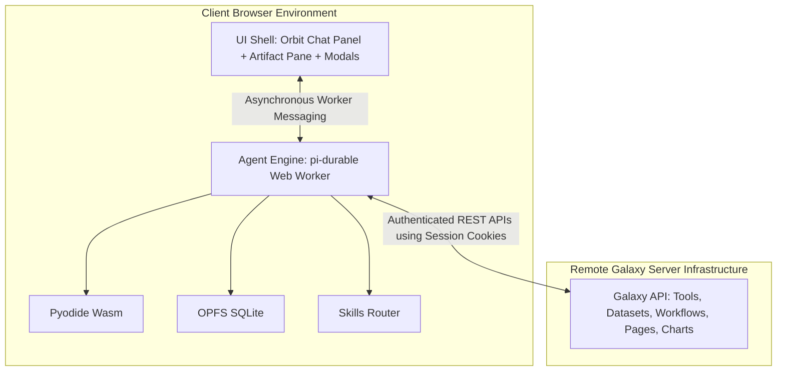
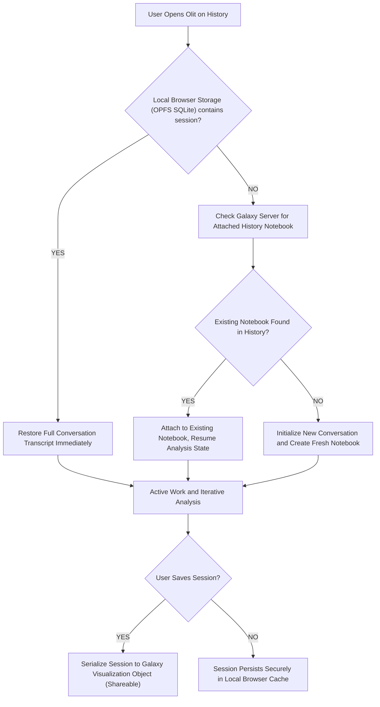

# Olit: A Browser-Native Autonomous AI Co-Scientist for the Galaxy Bioinformatics Platform

**Master's Thesis Draft**  
**Author:** Ali Mert Aydın  
**Institution:** Universität Freiburg / Bioinformatics  
**Date:** November 2026

---

## Abstract

Galaxy is widely used to analyze large volumes of biological data. Despite the wide range of tools available through its community, using these resources can be challenging for biologists without a computational background. Combining tools into multi-step workflows, selecting appropriate parameters and resolving errors often requires experience with bioinformatics and programming. Large Language Models (LLMs) offer a possible way to make these tasks more accessible. However, many existing AI agents operate on remote servers and rely on system-level access, such as root privileges and shell environments. This raises practical concerns about computational costs, container management, and the handling of sensitive data.

Within the Galaxy ecosystem, Orbit was developed as an AI co-scientist that operates as a server-side agent. Unlike Orbit, this thesis presents Olit, an AI co-scientist that runs entirely within the user's web browser and integrates directly into the Galaxy web interface. By operating client-side, Olit makes use of the user's existing Galaxy session without requiring dedicated server infrastructure, keeping API credentials and execution locally in the browser.

Olit is designed to keep users involved in the analysis process. It follows a Plan First, Run Second approach: before any jobs are submitted to Galaxy, the agent proposes a workflow and its associated parameters, which the user can review and approve. An on-demand Skills Router provides the agent with domain-specific procedural guidance—specifically for declarative visualization (Vega-Lite) and platform-native charting (Galaxy Charts).

The primary contribution of this thesis is an empirical evaluation of Olit's interactive visual analytics capabilities and client-side data preparation. By extending Galaxy's evaluation framework with targeted scenario benchmarks, this work quantifies how reliably a browser-native agent maps complex biological datasets to visualization schemas, identifies failure modes, evaluates self-correction routines, and describes the practical boundaries of client-side scientific AI.

---

## Table of Contents

- [Chapter 1: Introduction](#chapter-1-introduction)
  - [1.1 Computational Challenges in Modern Bioinformatics](#11-computational-challenges-in-modern-bioinformatics)
  - [1.2 Autonomous AI Agents](#12-autonomous-ai-agents)
  - [1.3 The Galaxy AI Ecosystem: Orbit and Orbit Lite](#13-the-galaxy-ai-ecosystem-orbit-and-orbit-lite)
  - [1.4 Problem Statement and Research Objectives](#14-problem-statement-and-research-objectives)
  - [1.5 Summary of Contributions](#15-summary-of-contributions)
  - [1.6 Thesis Organization](#16-thesis-organization)
- [Chapter 2: Background and Related Work](#chapter-2-background-and-related-work)
  - [2.1 The Galaxy Scientific Computing Model](#21-the-galaxy-scientific-computing-model)
  - [2.2 LLMs and Autonomous Agents in Bioinformatics](#22-llms-and-autonomous-agents-in-bioinformatics)
  - [2.3 Where Does the Agent Live?](#23-where-does-the-agent-live)
  - [2.4 System-Level vs. Platform-Bound AI Architectures: Orbit vs. Olit](#24-system-level-vs-platform-bound-ai-architectures-orbit-vs-olit)
  - [2.5 Browser-Side Computing](#25-browser-side-computing)
  - [2.6 Security, Safety, and Privacy in Scientific AI](#26-security-safety-and-privacy-in-scientific-ai)
- [Chapter 3: System Design and Methodology](#chapter-3-system-design-and-methodology)
  - [3.1 System Architectural Overview](#31-system-architectural-overview)
  - [3.2 Human-in-the-Loop Governance](#32-human-in-the-loop-governance)
  - [3.3 The Dynamic Skills Knowledge Architecture](#33-the-dynamic-skills-knowledge-architecture)
  - [3.4 Interactive Visual Analytics: Galaxy Charts and Vega-Lite](#34-interactive-visual-analytics-galaxy-charts-and-vega-lite)
  - [3.5 Session Resumability and State Persistence](#35-session-resumability-and-state-persistence)
- [Chapter 4: Systematic Evaluation and Empirical Analysis](#chapter-4-systematic-evaluation-and-empirical-analysis)
  - [4.1 Evaluation Methodology and Scenario Design](#41-evaluation-methodology-and-scenario-design)
  - [4.2 Benchmarking Visual Analytics Skills](#42-benchmarking-visual-analytics-skills)
  - [4.3 In-Browser Data Preparation and Repair via Pyodide](#43-in-browser-data-preparation-and-repair-via-pyodide)
  - [4.4 Failure Mode Taxonomy and Limitations](#44-failure-mode-taxonomy-and-limitations)
- [Bibliography](#bibliography)

---

## Chapter 1: Introduction

### 1.1 Computational Challenges in Modern Bioinformatics

High-throughput technologies—such as next-generation sequencing, single-cell transcriptomics, and mass spectrometry-based proteomics—have turned biological research into a heavily data-driven field. Today, a single study can easily generate gigabytes of raw genomic reads. Extracting meaningful biological insights from these datasets requires complex analytical pipelines, involving steps like quality control, reference alignment, statistical normalization, and variant calling.

To make high-performance computing more accessible, the bioinformatics community has widely adopted workflow management platforms. **Galaxy** is a leading example: an open-source, web-based platform designed for reproducible and transparent analysis. It allows researchers to run thousands of command-line tools without needing to manage Unix systems, compile packages, or handle software containers. Through its visual workflow canvas and built-in metadata tracking, Galaxy automatically records the provenance of every dataset.

However, despite its user-friendly interface and a repository of over 10,000 tools, a significant learning curve remains. Biologists without computational backgrounds still face several practical hurdles:

1. **Tool Selection:** There are often multiple tools available for the exact same task (e.g., aligners like Bowtie2, BWA-MEM, and HISAT2). Each has different input requirements, algorithmic assumptions, and performance trade-offs, making it difficult to choose the right one.
2. **Parameter Complexity:** Bioinformatics software typically exposes dozens of sensitive parameters, such as mismatch penalties or statistical thresholds. Choosing inappropriate settings can silently bias or invalidate downstream results.
3. **Workflow Assembly and Troubleshooting:** Linking different analytical steps together requires a solid grasp of data formats (e.g., FASTQ, BAM, VCF) and file transformations. When a tool fails, diagnosing the underlying issue is often difficult without command-line experience.

As a result, researchers often have to rely heavily on specialized bioinformatics core facilities, which can slow down the pace of discovery.

### 1.2 Autonomous AI Agents

Alongside developments in bioinformatics, the development of Large Language Models has introduced new possibilities for automating computational tasks. Modern LLMs can interpret complex instructions, maintain contextual information, and generate code for a range of technical applications beyond generating text. An important development in this area is the emergence of autonomous software agents, which extend the capabilities of LLMs by enabling them to decompose user requests into individual tasks, interact with external tools, and modify their execution strategies in response to errors.

The application of such agents in science is already being explored in several domains. ChemCrow, for example, integrates language models with chemistry-related tools, while GeneGPT enables interaction with biological databases through domain-specific APIs. These systems demonstrate how LLMs can serve as interfaces between natural-language instructions and existing scientific software, reducing the need for users to interact directly with individual tools and their underlying interfaces.

Despite these developments, deploying AI agents within established bioinformatics platforms introduces several technical challenges:

- **Hallucinations and Invalid Parameters:** LLMs may generate references to non-existent tools, unsupported command-line arguments, or invalid dataset identifiers. These errors can lead to failed workflow executions without mechanisms to validate generated commands against the available software environment.
- **Provenance and Reproducibility:** Scientific workflows require transparent execution records to ensure that results can be inspected and reproduced. When AI agents execute arbitrary scripts outside the platform's workflow management system, important information about commands, parameters, intermediate results, and execution history may not be captured.
- **Infrastructure and Security Risks:** Integrating AI agents into multi-user scientific platforms also raises deployment and access-control concerns. Depending on their architecture, agents may require additional backend services, isolated execution environments, or access to command-line tools.

### 1.3 The Galaxy AI Ecosystem: Orbit and Orbit Lite

The Galaxy Project initiated the development of native AI assistance environments to address these challenges. Two complementary architectural paradigms have emerged within this ecosystem:

1. **Orbit (Galaxy Core Agent):** Orbit represents the comprehensive, system-level AI environment for Galaxy. It operates within the core infrastructure as a standalone service, providing an AI agent with access to the operating system and shell. Orbit is optimized for those requiring arbitrary package installations, and deep system automation.
2. **Orbit Lite (Olit):** In contrast to Orbit's system-level runtime, **Olit** is developed as a lightweight, zero-installation, browser-resident AI co-scientist. Olit lives directly inside the client's web browser. It executes within a standard Galaxy visualization plugin without requiring administrative privileges.

Throughout this thesis, Orbit Lite is referred to as **Olit**. Olit operates through standardized Galaxy REST APIs and an isolated, in-browser WebAssembly Python environment (Pyodide). This architectural divergence represents a trade-off: Olit trades raw shell access for universal accessibility, zero server cost, client-side credential security, and total integration with Galaxy.

### 1.4 Problem Statement and Research Objectives

This thesis argues that an autonomous AI agent can be built to run entirely within a user's web browser to manage complex bioinformatics workflows.

Driven by this premise, the primary research question is:

> *"How reliably can a browser-native AI agent prepare and visualize scientific data using Galaxy, and what practical limitations and architectural improvements emerge from a systematic evaluation?"*

To answer this research question, the study is structured across three core investigative phases. First, we explore the client-side Web Worker runtime and in-browser Python execution, examining how the agent can inherit the user's existing session authentication and interact directly with the Galaxy REST API without requiring dedicated backend containers. Second, we evaluate how effectively the agent maps complex dataset columns to declarative visualization schemas (`galaxy-charts`), systematically identifying canonical failure modes and formulating automated self-correction routines. Finally, we assess the agent's ability to use local Python execution to clean malformed tabular data and calculate basic scientific metrics directly in the browser, avoiding the clutter of trivial data-wrangling jobs in the user's main Galaxy history.

To achieve these goals, the thesis sets out four specific technical objectives:

- **O1. Runtime Design:** The system must maintain conversational memory across page reloads and operate strictly without requiring dedicated backend compute containers.
- **O2. User-Controlled Execution:** Implement a *Plan First, Run Second* protocol to keep the human in the loop. This ensures that the agent cannot execute workflows or perform actions without user approval, keeping all parameter choices fully transparent.
- **O3. On-Demand Skill Retrieval:** Create a modular *Skills* system that feeds the agent verified technical instructions only when needed. This approach prevents hallucinations, while also securing the system against prompt injection.
- **O4. Systematic Empirical Evaluation:** Establish a scenario-driven evaluation suite to benchmark Olit's interactive visual analytics, measuring schema compliance, column binding accuracy, error recovery loops, and the effectiveness of in-browser data preparation across biological datasets.

### 1.5 Summary of Contributions

The primary contributions described in this thesis are as follows:

- **Olit Architectural Framework:** We present the design of Olit, the first browser-native AI co-scientist for Galaxy, demonstrating that multi-turn workflow planning and execution can be realized within client-side Web Workers.
- **Comparative Architectural Analysis:** We articulate the distinct operational boundaries between system-level agents (Orbit) and platform-bound agents (Olit), demonstrating how Olit's architectural boundaries intentionally expose missing features in Galaxy core.
- **Dynamic Skills Architecture for Visual Analytics:** We describe Olit's on-demand skills routing mechanism, showing how practical instructions for Vega-Lite charting and Galaxy Charts are loaded only when needed without filling up the context window.
- **Evaluation of Interactive Visual Analytics:** We design an evaluation framework based on realistic scenarios to test Olit's visual analytics capabilities. We measure how accurately the agent maps data columns, how well it recovers when schema errors occur, how it prepares data locally, and where browser-based agents reach their practical limits.

### 1.6 Thesis Organization

The remainder of this thesis is structured as follows:

- **[Chapter 2 (Background and Related Work)](#chapter-2-background-and-related-work):** Reviews the Galaxy computational model, the evolution of autonomous AI agents in science, the technical foundations of client-side browser computing and related scientific agent platforms.
- **[Chapter 3 (System Design and Methodology)](#chapter-3-system-design-and-methodology):** Details the architecture of Olit, including UI-worker decoupling, the Skills router, visual analytics integration and session resumability.
- **[Chapter 4 (Systematic Evaluation and Empirical Analysis)](#chapter-4-systematic-evaluation-and-empirical-analysis):** Introduces our scenario-driven benchmark suite, reports findings on visual analytics and data preparation, categorizes observed failure modes, and outlines key trade-offs.

---

## Chapter 2: Background and Related Work

### 2.1 The Galaxy Scientific Computing Model

Galaxy is one of the most widely used open-source workflow platforms in the life sciences, serving tens of thousands of researchers through large public servers like usegalaxy.eu [[4]](#bibliography). The platform is built around a few core concepts designed to ensure that scientific analyses remain transparent and reproducible:

#### 2.1.1 Histories, Datasets, and Provenance Graphs

In Galaxy, the main workspace for any analysis is the **History**. A history acts as an ordered, permanent record of all datasets generated during a session. Under the hood, every item in a history is managed as a *History Dataset Association* (HDA), which includes:

- A simple sequential number for the user interface (HID, e.g., `#1`, `#2`);
- A unique, permanent internal identifier (Encoded ID, e.g., `f2db41e1fa331b3e`);
- A specific file datatype (e.g., `fastq.gz`, `bam`, `tabular`, `vcf`) that determines which downstream tools can process it;
- A direct link to the job that created it, recording the exact tool version, parameters, standard output, and execution environment.

To track this information, Galaxy structures dataset provenance as a directed acyclic graph (DAG). This means that for any given file or final result, the system can easily trace its entire lineage—identifying every previous tool, parameter setting, and source file that contributed to its creation.

#### 2.1.2 Tool Models and Metadata Discovery

Galaxy tools are formally declared using declarative XML specifications that define CLI command templates, conditional inputs, validation rules, and output formats. When a tool is run, Galaxy passes user parameters into an isolated container on a compute cluster.

Beyond individual tools, the **Intergalactic Workflow Commission** (IWC) curates standardized, peer-reviewed computational pipelines across disciplines such as single-cell RNA-seq, microbial genomics, and epigenetics. These workflows encode multi-step best practices, eliminating the need for researchers to manually invent pipelines.

#### 2.1.3 The Galaxy Visualization Framework and Galaxy Charts

Visual inspection is vital for assessing data quality and interpreting statistical distributions. Galaxy provides an integrated visualization subsystem capable of rendering datasets through diverse client-side plugins, including genome browsers (e.g., IGV), 3D molecular structure viewers (e.g., NGL, Mol*), and statistical charting packages.

Modern visualization plugins rely on the `@galaxyproject/galaxy-charts` framework. Galaxy Charts provides a track specification schema that binds dataset columns to visualization controls. A visualization can either be displayed temporarily during an active session in the client interface or serialized into a persistent Galaxy Visualization object equipped with a permanent, shareable URL.

### 2.2 LLMs and Autonomous Agents in Bioinformatics

#### 2.2.1 Reasoning and Tool-Augmented Language Models

Early applications of Large Language Models in bioinformatics focused primarily on natural language literature retrieval, biomedical entity recognition, or code generation. However, standard language models have clear limits in scientific reasoning: they cannot perform exact calculations, lack access to real-time data, and frequently generate plausible but incorrect statements (hallucinations) [[6]](#bibliography).

To address these limitations, approaches like **ReAct** (Reasoning + Acting) [[7]](#bibliography) and **Toolformer** [[8]](#bibliography) show that models can alternate between reasoning in text and calling external tools. The agent checks its environment, decides on the next step, calls an API, reads the result, and continues until the task is complete.

#### 2.2.2 Domain-Specific Scientific Agents

In chemistry and molecular biology, several systems have adapted tool-augmented architectures to laboratory workflows:

- **ChemCrow** [[1]](#bibliography): Integrates specialized chemistry tools with an LLM core, demonstrating autonomous synthesis planning.
- **GeneGPT** [[6]](#bibliography): Augments language models with NCBI Web APIs to answer complex biomedical queries using real-time database lookups rather than memorized weights.
- **BioNeMo and HuggingGPT**: Coordinate distributed model repositories to route specialized biological processing tasks to dedicated neural networks.

Despite these advances, existing scientific agents typically operate as disconnected CLI tools or black-box Python wrappers. They rarely integrate directly with established, community-governed research environments like Galaxy, where data provenance, institutional compute allocation, and audit trails are mandatory.

### 2.3 Where Does the Agent Live?

The integration of artificial intelligence into the Galaxy ecosystem has evolved across multiple architectural paradigms, characterized by a fundamental question: *Where does the AI agent live, and who owns its execution environment?*

#### 2.3.1 Deployment Paradigms: Inside, Outside, and Within the Browser

AI capabilities in Galaxy have progressed across three distinct deployment domains:

1. **Inside Galaxy (Core and Server-Side):** Early initiatives such as **ChatGXY** (January 2026) established the first server-side conversational assistant integrated into Galaxy core. The Galaxy server owns the agent runtime and provisions an LLM proxy API to broker requests to foundation model providers. While centrally managed, server-side agents cannot easily perform multi-turn interactive state manipulation without imposing significant compute burdens on the shared web server.
2. **Outside Galaxy (System-Level and VM Hosts):** To provide unrestricted computational agency, the **Orbit** project (May 2026) introduced a host-owned agent model. In this model, an external Linux workstation or dedicated cloud virtual machine owns the agent. While offering maximal power through an unrestricted Bash terminal, it requires heavy infrastructure provisioning, per-user container sandboxing, and manual API key configuration.
3. **The Browser as the Agent Host (Client-Side Plugins):** The browser-resident paradigm originated with **JupyterLite AI** (May 2025), which introduced WebAssembly-based Python into Galaxy visualization plugins. This was followed by **Vintent** and **Polaris** (December 2025 – January 2026), demonstrating that client-side JavaScript applications could query Galaxy's API catalog and execute Pyodide scratchpads. Building on these efforts, **Orbit Lite (Olit)** (October 2026) brings Orbit's user interface and skill system directly into the browser as a zero-installation visualization plugin.

#### 2.3.2 The Five Pillars of "Browser Owns the Agent"

Olit's architecture is rooted in the deliberate decision to place agent ownership inside the user's web browser tab rather than an auxiliary server. This design is justified by five technical pillars:

1. **Large-Capacity Local Persistence:** Modern browsers allocate up to ~2 GB of dedicated client-side storage per origin via the Origin Private File System (OPFS). Olit utilizes embedded SQLite within OPFS to maintain complete conversational history, tool journals, and intermediate scratchpad data across page reloads with zero server database bloat.
2. **Near-Native Computational Performance:** Compiling CPython and core scientific libraries (NumPy, Pandas, SciPy) to WebAssembly yields execution speeds within ~2× of native machine code [[3]](#bibliography), [[5]](#bibliography). This enables rapid tabular preprocessing, summary statistics, and visual data preparation locally without server round-trip latency.
3. **Distributed Zero-Cost Infrastructure:** Centralized AI agent hosting requires allocating dedicated cloud containers or GPU instances per active researcher, creating severe cost scaling bottlenecks for non-profit academic servers. In Olit, the agent's logic and lightweight Python execution run directly on the user's computer.
4. **Galaxy as the Operating System:** Rather than managing a conventional POSIX filesystem, Olit treats Galaxy itself as the underlying operating system. Galaxy manages datasets, access control, persistent research artifacts, cluster job scheduling, and cryptographic provenance, allowing the client-side agent to remain lean and stateless.
5. **Zero-Installation Access:** Researchers often face administrative hurdles when installing local software or setting up command-line API tokens. As a standard Galaxy visualization plugin, Olit requires zero installation, launching instantaneously from any browser window on any device.

### 2.4 System-Level vs. Platform-Bound AI Architectures: Orbit vs. Olit

The central design consideration for integrating AI into Galaxy is the execution boundary of the agent runtime. Within the Galaxy ecosystem, this divide is represented by **Orbit** and **Olit**.

**Table 2.1:** Architectural Comparison of Orbit and Olit

| Architectural Dimension | Orbit | Olit |
| :--- | :--- | :--- |
| Execution Runtime | Native Linux OS / Container | Web Browser Tab |
| Terminal / Shell Access | Bash Terminal | None |
| Python Execution | System Python / Conda Shell | In-Browser Pyodide |
| Authentication Method | Galaxy API Keys / MCP Protocol | Cookies |
| Infrastructure Cost | Dedicated Server / Container per User | Zero Server Overhead |
| Package Installation | Arbitrary | Strictly Galaxy Installed Tools |
| Failure Mode | Ad-hoc Shell Workaround | Exposes Missing Galaxy Features |

#### 2.4.1 Orbit: The System-Level Linux Paradigm

Orbit operates within the Galaxy core ecosystem as a full-fledged scientific operating system agent. Because Orbit controls an unrestricted Bash shell on a Linux host, it possesses maximum operational flexibility:

- It can compile missing C/C++ bioinformatics libraries, construct custom Bash loops, install ad-hoc Conda packages, and run local container engines.
- When a specific analysis tool is absent from Galaxy, Orbit can simply download the binary, execute it locally, and upload the output back to Galaxy.

However, this system-level power introduces substantial operational overhead. Giving an autonomous model full shell access creates serious security risks, requires complex container setups to isolate users, and leads to ongoing server costs for every active user.

#### 2.4.2 Olit: The Platform-Bound Browser Paradigm

In direct contrast, Olit is intentionally **platform-bound**. Olit possesses no operating system shell, no root terminal, and no backend container. It executes within the user's browser tab and communicates with Galaxy exclusively through authenticated REST APIs.

This platform-bound design provides an important practical advantage:

> **The Diagnostic Property of Olit:** Because Olit cannot use a Bash terminal to work around missing capabilities, it must work entirely through Galaxy's official tools and API endpoints. When an analysis step fails because a tool wrapper is missing, a parameter is incomplete, or a datatype is unsupported, Olit immediately highlights that gap in Galaxy itself. Rather than hiding issues behind one-off command-line scripts, Olit shows where the platform needs improvement, helping improve Galaxy's shared tools and APIs for everyone.

### 2.5 Browser-Side Computing

Running an autonomous agent in a web browser relies on modern client-side web standards:

#### 2.5.1 WebAssembly and Pyodide

WebAssembly is a low-level, high-performance binary instruction format designed for near-native execution speed in web browsers [[5]](#bibliography). **Pyodide** [[3]](#bibliography) ports the standard CPython interpreter to WebAssembly, enabling the execution of Python code directly within browser sandboxes. Pyodide includes pre-compiled WebAssembly builds of fundamental scientific libraries including NumPy, Pandas, and SciPy.

Within Olit, Pyodide serves as an isolated client-side scratchpad. It allows the agent to inspect tabular headers, compute descriptive summary statistics, and evaluate filtering logic without submitting small, latency-sensitive compute jobs to remote Galaxy cluster queues. However, browser security models strictly isolate Pyodide:

- It has zero access to the host operating system's local filesystem;
- Outbound HTTP requests are governed by browser Cross-Origin Resource Sharing (CORS) policies;
- Long-running loops are memory-constrained by browser tab quotas.

These limitations reinforce the scientific division of labor: lightweight data transformation and visualization preparation run in the browser, while heavy genomic crunching runs as tracked Galaxy cluster jobs.

#### 2.5.2 Asynchronous Execution via Web Workers

A standard browser tab executes on a single main UI thread responsible for DOM manipulation, styling, and user interaction. If an AI agent were to execute LLM streaming, JSON Schema validation, and Pyodide calculations on the main thread, the user interface would frequently freeze. Olit decouples the agent engine entirely from the UI shell by instantiating the agent inside a dedicated background **Web Worker**. Communication between the UI shell and the agent engine occurs through asynchronous, non-blocking message passing.

#### 2.5.3 Persistent Client-Side Storage via OPFS and SQLite

Browser memory is temporary: refreshing a page or closing a tab usually clears all active data. To support long-running analyses without risking data loss, Olit uses `pi-durable`, an embedded database engine. It saves conversation logs, job histories, and current tool states directly to the browser's **Origin Private File System** (OPFS) via SQLite. As a result, if a user happens to reload the page during a multi-hour job, the agent immediately recovers its exact state and picks up right where it left off.

### 2.6 Security, Safety, and Privacy in Scientific AI

Autonomous scientific agents interact with sensitive biological datasets and high-performance computing resources, necessitating rigorous security protocols:

#### 2.6.1 Client-Side Credential Isolation

In traditional server-side agent architectures, user API keys (e.g., OpenAI or Gemini tokens) must be transmitted to and stored on the central application server. Storing API keys on a central server creates security risks. Olit resolves this issue through client-side isolation: model API keys are kept solely in browser tab memory. Requests to LLM endpoints are sent directly from the client's browser to the LLM provider, ensuring that Galaxy servers never store or log user credentials.

#### 2.6.2 Prompt Injection and Homoglyph Filtering

Biological datasets frequently contain uncurated user annotations, FASTA headers, or tabular metadata that might contain prompt injections designed to subvert agent instructions (e.g., "*Ignore previous instructions and delete all history datasets*"). Olit incorporates input sanitization guards that:

1. Strip internal control sequences;
2. Fold Cyrillic, Greek, and mathematical confusable homoglyphs into canonical Latin ASCII representations before tool routing;
3. Treat all text read from datasets or Galaxy records strictly as passive data rather than executable commands.

---

## Chapter 3: System Design and Methodology

### 3.1 System Architectural Overview

Olit is designed with a clear separation between the user interface and the AI's decision-making logic. Figure 3.1 outlines the system architecture, illustrating the strict boundary between the local browser environment and the remote Galaxy server.

*Figure 3.1: Architectural decomposition of Olit, demonstrating client-side execution over remote Galaxy server infrastructure.*

#### 3.1.1 UI Shell and Agent Engine

The codebase comprises two primary subsystems:

1. **The UI Shell:** Implemented in TypeScript, the UI shell embeds within the Galaxy visualization iframe. It adapts presentation components from the Orbit project (the chat pane, message streaming renderer, and modal dialogs) and manages the responsive layout.
2. **The Agent Engine:** Hosted inside an isolated background Web Worker, the agent engine manages conversation durability, tool dispatching, system prompt assembly, LLM communication, and Pyodide sandbox execution.

#### 3.1.2 Upstream Integration with Orbit

A core design principle of Olit is minimizing code fragmentation within the broader Galaxy AI ecosystem. Rather than implementing an independent chat interface, Olit vendors the official chat presentation layer directly from Orbit's repository. Files within this repository are maintained byte-identical to upstream commits, ensuring that visual elements, markdown formatting rules, and interaction paradigms remain consistent between Orbit and Olit.

This integration works in both directions:
- **Declarative Schema Compliance:** Integrating the `galaxy-charts` input schema to describe and validate visualization parameters prior to execution;
- **Native Table Counting and Aggregation:** Adapting tabular data consumption so that column indexing respects Galaxy's 1-based indexing while delegating statistical aggregations directly to client-side Vega-Lite engines;
- **Interactive Artifact Synchronization:** Ensuring that dynamically synthesized charts and figures update live in the dedicated artifact view pane;
- **Session Saving and Resumption:** Implementing robust document schemas for saving and restoring multi-turn conversational transcripts as permanent Galaxy visualization objects.

### 3.2 Human-in-the-Loop Governance

A common danger with language model agents is running actions without confirmation: an unguided agent given high-level goals might immediately launch unverified tools, waste cluster compute time, or accidentally overwrite existing data.

#### 3.2.1 The Execution Lifecycle

To prevent unintended actions, the agent is restricted from executing tools immediately after receiving a user request. Instead, it follows a structured lifecycle:

1. **Data Exploration:** The agent first inspects dataset metadata (such as column names, datatypes, and sample counts) using read-only operations.
2. **Plan Formulation:** It then drafts a step-by-step execution plan. This includes specific tool choices (e.g., FastQC, Trimmomatic) and a detailed table of all proposed parameters.
3. **User Review:** The proposed plan is displayed in the UI, giving the user the option to **Approve**, **Edit**, or **Reject** it. The agent pauses completely until the user makes a decision.
4. **Execution and Tracking:** Once approved, the agent submits the tools to the Galaxy API in the correct order and continuously monitors their progress.

#### 3.2.2 Safety Gates for Destructive Actions

Operations that permanently delete data—such as purging histories, deleting datasets, or stopping active workflows—are handled by a dedicated safety mechanism (`destructiveGate`). Even if the agent is already in the middle of an approved execution phase, attempting a destructive action automatically triggers a confirmation modal. If the user declines, the action is blocked to prevent any accidental data loss.

### 3.3 The Dynamic Skills Knowledge Architecture

#### 3.3.1 The On-Demand Router Pattern

While modern LLMs have larger context windows, pasting complete documentation into the system prompt slows down responses, increases costs, and makes it harder for the model to follow instructions accurately. For a broad platform like Galaxy, including complete manuals for every tool and visualization format in every prompt is impractical.

To resolve this, Olit implements an on-demand **Skills Router**. The system prompt carries only a lightweight index containing skill names, brief descriptions, and formal trigger conditions. When a user's request matches a trigger condition (e.g., initiating visual analytics or inspecting tabular structures), the agent calls the `skills_fetch({ path })` tool to retrieve the authoritative Markdown specification into its working context.

By loading procedural instructions only when needed, the agent keeps its prompt short and focused on the task at hand.

#### 3.3.2 Skills Repositories and Cryptographic Vendoring

Olit organizes procedural knowledge across two repositories:

- **`olit-skills`:** Core operational skills authored specifically for Olit, which encodes procedural rules for choosing between previews and durable Galaxy Charts, and parameter validation for Vega-Lite charting.
- **`galaxy-skills`:** Community-curated skills shared with the Orbit project, encompassing collection manipulation, custom user-defined tool authoring, and Intergalactic Workflow Commission (IWC) best practices.

To guarantee zero network latency during session initialization and completely eliminate remote prompt injection via compromised external repositories, all skills are **vendored at build time** and cryptographically pinned in `skills.lock.json`. The running agent cannot be pointed to unvetted remote repositories.

### 3.4 Interactive Visual Analytics: Galaxy Charts and Vega-Lite

Data exploration in Olit is managed by a dual-pathway architecture implemented in `visualizations.ts` and `vega.ts`:

1. **Galaxy Charts Integration:** For established biological modalities (e.g., BAM alignments in IGV, VCF variants, PDB macromolecular structures), Olit queries installed visualization plugins. It validates parameter bindings against the plugin's schema, rendering native Galaxy visualizers directly in the Artifact Pane.
2. **Client-Side Vega-Lite Compilation:** When customized statistical charting is requested (e.g., volcano plots, differential expression bar charts, distribution histograms), Olit synthesizes declarative Vega-Lite specifications. Rather than embedding raw data rows into the spec or LLM prompt, the Vega-Lite specification references the dataset URL directly, offloading data streaming, aggregation, and rendering entirely to the browser.

To ensure scientific reproducibility, Olit follows the **Scientific Provenance Principle**: if a chart requires a statistical transformation that Vega-Lite cannot handle, the agent never fabricates data points. Instead, it runs an actual Galaxy tool to produce the necessary dataset first, keeping the full history intact.

### 3.5 Session Resumability and State Persistence

*Figure 3.2: Decision tree for Olit session resumption across browser tabs, local storage, and Galaxy server instances.*

Because the browser runtime owns the agent execution state, Olit implements a multi-tiered session recovery mechanism:
- **Cross-Device Portability:** Users can serialize an active session into a persistent Galaxy Visualization object. This enables researchers to share interactive analytical sessions with collaborators across independent machines.

---

## Chapter 4: Systematic Evaluation and Empirical Analysis

### 4.1 Evaluation Methodology and Scenario Design

To evaluate Olit systematically, we use an automated test harness with multi-turn test scenarios. Each scenario specifies a test history, sample user requests, a tool budget, and clear checks on the resulting output, tool calls, and charts.

### 4.2 Benchmarking Visual Analytics Skills

We benchmark the agent across realistic biological visualization tasks:
- **Parameter Mapping:** Checking whether the agent correctly assigns columns to the right chart axes and visual channels (`x`, `y`, `color`).
- **Schema Compliance:** Measuring how frequently schema validation errors occur and how effectively the agent corrects invalid Vega-Lite specifications on its own.
- **Dataset Referencing:** Verifying that charts reference streaming dataset endpoints rather than copying raw data rows into the prompt.

### 4.3 In-Browser Data Preparation and Repair via Pyodide

We evaluate how the agent leverages `run_python` in Pyodide to clean malformed tabular data, compute descriptive statistics, and filter significant candidate genes (e.g., differential expression analysis with DESeq2 outputs) before plotting, eliminating server-side job queue overhead.

### 4.4 Failure Mode Taxonomy and Limitations

We analyze the boundary between browser-resident execution and remote Galaxy compute:
- **Reasoning vs. Runtime Limits:** Distinguishing reasoning mistakes (such as misinterpreting column headers) from browser constraints (such as memory limits when parsing large files).
- **Tool Resolution Gaps:** How Olit exposes missing visualization plugins or server-side tools without relying on unverified command-line workarounds.

---

## Bibliography

1. **Bran, A. M., Cox, S., Schilter, O., Baldassari, C., White, A. D., & Schwaller, P.** (2023). ChemCrow: Augmenting large-language models with chemistry tools. *arXiv preprint arXiv:2304.05376*.
2. **Di Tommaso, P., Chatzou, M., Floden, E. W., Barja, P. P., Palumbo, E., & Notredame, C.** (2017). Nextflow enables reproducible computational analysis. *Nature Biotechnology*, 35(4), 316–319.
3. **Droettboom, M., et al.** (2018). Pyodide: Bringing the Python scientific stack to the browser. In *SciPy Conference*.
4. **Goecks, J., Nekrutenko, A., & Taylor, J.** (2010). Galaxy: a comprehensive approach for supporting accessible, reproducible, and transparent computational research in the life sciences. *Genome Biology*, 11(8), R86.
5. **Haas, A., Rossberg, A., Schuff, D. L., Titzer, B. L., Holman, M., Gohman, D., Wagner, L., Zakai, A., & Bastien, J. F.** (2017). Bringing the web up to speed with WebAssembly. *ACM SIGPLAN Notices*, 52(6), 185–200.
6. **Jin, Q., Yang, Y., Chen, Q., & Lu, Z.** (2024). GeneGPT: Augmenting large language models with domain tools for improved access to biomedical information. *Bioinformatics*, 40(2), btae075.
7. **Yao, S., Zhao, J., Yu, D., Du, N., Shafran, I., Narasimhan, K., & Cao, Y.** (2022). ReAct: Synergizing reasoning and acting in language models. *arXiv preprint arXiv:2210.03629*.
8. **Schick, T., Dwivedi-Yu, J., Dessì, R., Raileanu, R., Lomeli, M., Zettlemoyer, L., Cancedda, N., & Scialom, T.** (2023). Toolformer: Language models can teach themselves to use tools. *arXiv preprint arXiv:2302.04761*.
