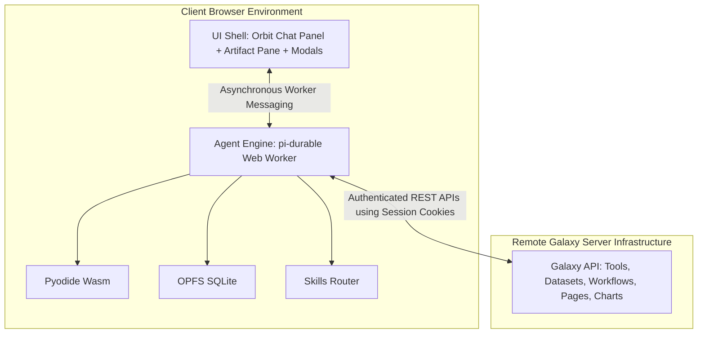
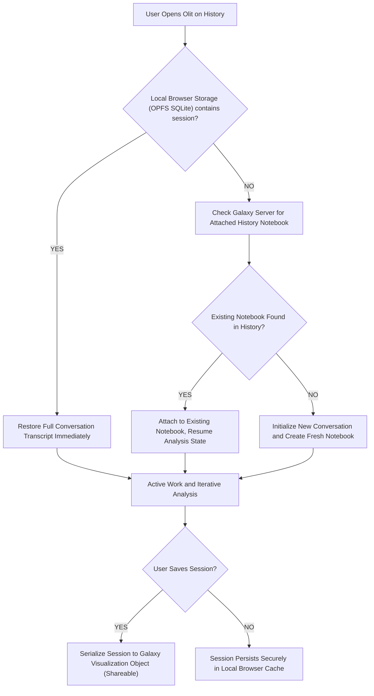

# Olit: A Browser-Native Autonomous AI Co-Scientist for the Galaxy Bioinformatics Platform

**Master's Thesis Draft**  
**Author:** Ali Mert Aydın  
**Institution:** Universität Freiburg / Bioinformatics  
**Date:** November 2026

---

## Abstract

Galaxy is widely used to analyze large volumes of biological data. Despite the wide range of tools available through its community, using these resources can be challenging for biologists without a computational background. Combining tools into multi-step workflows, selecting appropriate parameters and resolving errors often requires experience with bioinformatics and programming. Large Language Models (LLMs) offer a possible way to make these tasks more accessible. However, many existing AI agents operate on remote servers and rely on system-level access, such as root privileges and shell environments. This raises practical concerns about computational costs, container management, and the handling of sensitive data.

Within the Galaxy ecosystem, Orbit was developed as an AI co-scientist that operates as a server-side agent. Unlike Orbit, this thesis presents Olit, an AI co-scientist that runs entirely within the user's web browser and integrates directly into the Galaxy web interface. By operating client-side, Olit makes use of the user's existing Galaxy session without requiring dedicated server infrastructure, keeping API credentials and execution locally in the browser.

Olit is designed to keep users involved in the analysis process. It follows a Plan First, Run Second approach: before any jobs are submitted to Galaxy, the agent proposes a workflow and its associated parameters, which the user can review and approve. An on-demand Skills Router provides the agent with relevant technical knowledge when required, rather than loading all available information into the context window at once. Olit also integrates with Galaxy Charts to support interactive data visualization and can generate shareable Galaxy Pages that document the analysis and its results.

The thesis describes Olit's architecture and implementation, examines the trade-offs between browser-based and server-side AI agents, and evaluates the system through a case study involving biological data exploration.

---

## Table of Contents

- [Chapter 1: Introduction](#chapter-1-introduction)
  - [1.1 The Computational Dilemma in Modern Bioinformatics](#11-the-computational-dilemma-in-modern-bioinformatics)
  - [1.2 Autonomous AI Agents](#12-autonomous-ai-agents)
  - [1.3 The Galaxy AI Ecosystem: Orbit and Orbit Lite](#13-the-galaxy-ai-ecosystem-orbit-and-orbit-lite)
  - [1.4 Problem Statement and Research Objectives](#14-problem-statement-and-research-objectives)
  - [1.5 Summary of Contributions](#15-summary-of-contributions)
  - [1.6 Thesis Organization](#16-thesis-organization)
- [Chapter 2: Background and Related Work](#chapter-2-background-and-related-work)
  - [2.1 The Galaxy Scientific Computing Model](#21-the-galaxy-scientific-computing-model)
  - [2.2 LLMs and Autonomous Agents in Bioinformatics](#22-llms-and-autonomous-agents-in-bioinformatics)
  - [2.3 Where Does the Agent Live?](#23-where-does-the-agent-live)
  - [2.4 System-Level vs. Platform-Bound AI Architectures: Orbit vs. Olit](#24-system-level-vs-platform-bound-ai-architectures-orbit-vs-olit)
  - [2.5 Browser-Side Computing](#25-browser-side-computing)
  - [2.6 Security, Safety, and Privacy in Scientific AI](#26-security-safety-and-privacy-in-scientific-ai)
- [Chapter 3: System Design and Methodology](#chapter-3-system-design-and-methodology)
  - [3.1 System Architectural Overview](#31-system-architectural-overview)
  - [3.2 Human-in-the-Loop](#32-human-in-the-loop)
  - [3.3 The Dynamic Skills Knowledge Architecture](#33-the-dynamic-skills-knowledge-architecture)
  - [3.4 Data Visualization and Interactive Analytics](#34-data-visualization-and-interactive-analytics)
  - [3.5 Session Resumability and Automated Notebooks](#35-session-resumability-and-automated-notebooks)
- [Bibliography](#bibliography)

---

## Chapter 1: Introduction

### 1.1 The Computational Dilemma in Modern Bioinformatics

High-throughput technologies—such as next-generation sequencing, single-cell transcriptomics, and mass spectrometry-based proteomics—have turned biological research into a heavily data-driven field. Today, a single study can easily generate gigabytes of raw genomic reads. Extracting meaningful biological insights from these datasets requires complex analytical pipelines, involving steps like quality control, reference alignment, statistical normalization, and variant calling.

To make high-performance computing more accessible, the bioinformatics community has widely adopted workflow management platforms. **Galaxy** is a leading example: an open-source, web-based platform designed for reproducible and transparent analysis. It allows researchers to run thousands of command-line tools without needing to manage Unix systems, compile packages, or handle software containers. Through its visual workflow canvas and built-in metadata tracking, Galaxy automatically records the provenance of every dataset.

However, despite its user-friendly interface and a repository of over 10,000 tools, a significant learning curve remains. Biologists without computational backgrounds still face several practical hurdles:

1. **Tool Selection:** There are often multiple tools available for the exact same task (e.g., aligners like Bowtie2, BWA-MEM, and HISAT2). Each has different input requirements, algorithmic assumptions, and performance trade-offs, making it difficult to choose the right one.
2. **Parameter Complexity:** Bioinformatics software typically exposes dozens of sensitive parameters, such as mismatch penalties or statistical thresholds. Choosing inappropriate settings can silently bias or invalidate downstream results.
3. **Workflow Assembly and Troubleshooting:** Linking different analytical steps together requires a solid grasp of data formats (e.g., FASTQ, BAM, VCF) and file transformations. When a tool fails, diagnosing the underlying issue is often difficult without command-line experience.

As a result, researchers often have to rely heavily on specialized bioinformatics core facilities, which can slow down the pace of discovery.

### 1.2 Autonomous AI Agents

Alongside developments in bioinformatics, the development of Large Language Models has introduced new possibilities for automating computational tasks. Modern LLMs can interpret complex instructions, maintain contextual information, and generate code for a range of technical applications beyond generating text. An important development in this area is the emergence of autonomous software agents, which extend the capabilities of LLMs by enabling them to decompose user requests into individual tasks, interact with external tools, and modify their execution strategies in response to errors.

The application of such agents in science is already being explored in several domains. ChemCrow, for example, integrates language models with chemistry-related tools, while GeneGPT enables interaction with biological databases through domain-specific APIs. These systems demonstrate how LLMs can serve as interfaces between natural-language instructions and existing scientific software, reducing the need for users to interact directly with individual tools and their underlying interfaces.

Despite these developments, deploying AI agents within established bioinformatics platforms introduces several technical challenges:

- **Hallucinations and Invalid Parameters:** LLMs may generate references to non-existent tools, unsupported command-line arguments, or invalid dataset identifiers. These errors can lead to failed workflow executions without mechanisms to validate generated commands against the available software environment.
- **Provenance and Reproducibility:** Scientific workflows require transparent execution records to ensure that results can be inspected and reproduced. When AI agents execute arbitrary scripts outside the platform's workflow management system, important information about commands, parameters, intermediate results, and execution history may not be captured.
- **Infrastructure and Security Risks:** Integrating AI agents into multi-user scientific platforms also raises deployment and access-control concerns. Depending on their architecture, agents may require additional backend services, isolated execution environments, or access to command-line tools.

### 1.3 The Galaxy AI Ecosystem: Orbit and Orbit Lite

The Galaxy Project initiated the development of native AI assistance environments to address these challenges. Two complementary architectural paradigms have emerged within this ecosystem:

1. **Orbit (Galaxy Core Agent):** Orbit represents the comprehensive, system-level AI environment for Galaxy. It operates within the core infrastructure as a standalone service, providing an AI agent with access to the operating system and shell. Orbit is optimized for those requiring arbitrary package installations, and deep system automation.
2. **Orbit Lite (Olit):** In contrast to Orbit's system-level runtime, **Olit** is developed as a lightweight, zero-installation, browser-resident AI co-scientist. Olit lives directly inside the client's web browser. It executes within a standard Galaxy visualization plugin without requiring administrative privileges.

Throughout this thesis, Orbit Lite is referred to as **Olit**. Olit operates through standardized Galaxy REST APIs and an isolated, in-browser WebAssembly Python environment (Pyodide). This architectural divergence represents a trade-off: Olit trades raw shell access for universal accessibility, zero server cost, client-side credential security, and total integration with Galaxy.

### 1.4 Problem Statement and Research Objectives

This thesis argues that an autonomous AI agent can be built to run entirely within a user's web browser to manage complex bioinformatics workflows.

Driven by this premise, the primary research question is:

> *"How reliably can a browser-native AI agent prepare and visualize scientific data using Galaxy, and what practical limitations and architectural improvements emerge from a systematic evaluation?"*

To answer this research question, the study is structured across three core investigative phases. First, we explore the client-side Web Worker runtime and in-browser Python execution, examining how the agent can inherit the user's existing session authentication and interact directly with the Galaxy REST API without requiring dedicated backend containers. Second, we evaluate how effectively the agent maps complex dataset columns to declarative visualization schemas (`galaxy-charts`), systematically identifying canonical failure modes and formulating automated self-correction routines. Finally, we assess the agent's ability to use local Python execution to clean malformed tabular data and calculate basic scientific metrics directly in the browser, avoiding the clutter of trivial data-wrangling jobs in the user's main Galaxy history.

To operationalize these phases, the research pursues four concrete technical objectives:

- **O1. Runtime Design:** The system must maintain conversational memory across page reloads and operate strictly without requiring dedicated backend compute containers.
- **O2. User-Controlled Execution:** Implement a *Plan First, Run Second* protocol to keep the human in the loop. This ensures that the agent cannot execute workflows or perform actions without user approval, keeping all parameter choices fully transparent.
- **O3. On-Demand Skill Retrieval:** Create a modular *Skills* system that feeds the agent verified technical instructions only when needed. This approach prevents hallucinations, while also securing the system against prompt injection.
- **O4. Provenance and Documentation:** Develop a pipeline that automatically tracks the analytical process. It should seamlessly convert executed Galaxy jobs, parameter settings, and interactive charts into permanent, shareable Galaxy Page notebooks.

### 1.5 Summary of Contributions

The primary contributions described in this thesis are as follows:

- **Olit Architectural Framework:** We present the design of Olit, the first browser-native AI co-scientist for Galaxy, demonstrating that multi-turn workflow planning and execution can be realized within client-side Web Workers.
- **Comparative Architectural Analysis:** We articulate the distinct operational boundaries between system-level agents (Orbit) and platform-bound agents (Olit), demonstrating how Olit's architectural boundaries intentionally expose missing features in Galaxy core.
- **Dynamic Skills Knowledge System:** We implement an on-demand skills routing and vendoring mechanism that delivers verified procedural guidance for notebook generation and visual analytics without context-window degradation.
- **Interactive Visual Analytics and Notebook Synthesis:** We integrate the Galaxy Charts framework with client-side Vega-Lite compilation, enabling both temporary exploratory charting and permanent durable visualization objects embedded within reproducible Galaxy Page reports.

### 1.6 Thesis Organization

The remainder of this thesis is structured as follows:

- **[Chapter 2 (Background and Related Work)](#chapter-2-background-and-related-work):** Reviews the Galaxy computational model, the evolution of autonomous AI agents in science, the technical foundations of client-side browser computing and related scientific agent platforms.
- **[Chapter 3 (System Design and Methodology)](#chapter-3-system-design-and-methodology):** Details the architecture of Olit, including UI-worker decoupling, the Skills router, visual analytics integration and session resumability.
- **Chapter 4 (Hands-on Case Study and Walkthrough):** Documents a complete experimental demonstration across sequential phases, analyzing intermediate artifacts, interactive parameter adjustments and final scientific report generation.

---

## Chapter 2: Background and Related Work

### 2.1 The Galaxy Scientific Computing Model

Galaxy is one of the most widely used open-source workflow platforms in the life sciences, serving tens of thousands of researchers through large public servers like usegalaxy.eu [[4]](#bibliography). The platform is built around a few core concepts designed to ensure that scientific analyses remain transparent and reproducible:

#### 2.1.1 Histories, Datasets, and Provenance Graphs

In Galaxy, the main workspace for any analysis is the **History**. A history acts as an ordered, permanent record of all datasets generated during a session. Under the hood, every item in a history is managed as a *History Dataset Association* (HDA), which includes:

- A simple sequential number for the user interface (HID, e.g., `#1`, `#2`);
- A unique, permanent internal identifier (Encoded ID, e.g., `f2db41e1fa331b3e`);
- A specific file datatype (e.g., `fastq.gz`, `bam`, `tabular`, `vcf`) that determines which downstream tools can process it;
- A direct link to the job that created it, recording the exact tool version, parameters, standard output, and execution environment.

To track this information, Galaxy structures dataset provenance as a directed acyclic graph (DAG). This means that for any given file or final result, the system can easily trace its entire lineage—identifying every previous tool, parameter setting, and source file that contributed to its creation.

#### 2.1.2 Tool Models and Metadata Discovery

x

#### 2.1.3 The Galaxy Visualization Framework and Galaxy Charts

x

### 2.2 LLMs and Autonomous Agents in Bioinformatics

x

### 2.3 Where Does the Agent Live?

1. **Inside Galaxy:** ChatGXY (January 2026)
2. **Outside Galaxy:** Orbit (May 2026)
3. **The Browser as the Agent Host:** JupyterLite AI (May 2025), Orbit Lite (October 2026)

#### 2.3.1 Browser Owns the Agent

Place agent ownership inside the user's web browser tab:

1. **2 GB of storage via the Origin Private File System**
2. **WebAssembly**
3. **Pyodide**
4. **Galaxy as the Operating System**
5. **Accessibility**

### 2.4 System-Level vs. Platform-Bound AI Architectures: Orbit vs. Olit

The central design consideration for integrating AI into Galaxy is the execution boundary of the agent runtime. Within the Galaxy ecosystem, this divide is embodied by **Orbit** and **Olit**.

**Table 2.1:** Architectural Comparison of Orbit and Olit

| Architectural Dimension | Orbit | Olit |
| :--- | :--- | :--- |
| Execution Runtime | Native Linux OS / Container | Web Browser Tab |
| Terminal / Shell Access | Bash Terminal | None |
| Python Execution | System Python / Conda Shell | In-Browser Pyodide |
| Authentication Method | Galaxy API Keys / MCP Protocol | Cookies |
| Infrastructure Cost | Dedicated Server / Container per User | Zero Server Overhead |
| Package Installation | Arbitrary | Strictly Galaxy Installed Tools |
| Failure Mode | Ad-hoc Shell Workaround | Exposes Missing Galaxy Features |

#### 2.4.1 Orbit: The System-Level Linux Paradigm

x

#### 2.4.2 Olit: The Platform-Bound Browser Paradigm

x

### 2.5 Browser-Side Computing

#### 2.5.1 WebAssembly and Pyodide

#### 2.5.2 Asynchronous Execution via Web Workers

#### 2.5.3 Persistent Client-Side Storage via OPFS and SQLite

Browser memory is temporary: refreshing a page or closing a tab usually clears all active data. To support long-running analyses without risking data loss, Olit uses `pi-durable`, an embedded database engine. It saves conversation logs, job histories, and current tool states directly to the browser's **Origin Private File System** (OPFS) via SQLite. As a result, if a user happens to reload the page during a multi-hour job, the agent immediately recovers its exact state and picks up right where it left off.

### 2.6 Security, Safety, and Privacy in Scientific AI

#### 2.6.1 Client-Side Credential Isolation

---

## Chapter 3: System Design and Methodology

### 3.1 System Architectural Overview

Olit is designed with a clear separation between the user interface and the AI's decision-making logic. Figure 3.1 outlines the system architecture, illustrating the strict boundary between the local browser environment and the remote Galaxy server.

*Figure 3.1: Architectural decomposition of Olit, demonstrating client-side execution over remote Galaxy server infrastructure.*

The codebase comprises two primary subsystems:

1. **The UI Shell**
2. **The Agent Engine**

### 3.2 Human-in-the-Loop

A critical vulnerability of naive language model agents is precipitous action: an unconstrained agent given high-level goals may immediately execute unverified tools, consume substantial cluster allocations, or inadvertently overwrite research data.

#### 3.2.1 The Execution Lifecycle

To prevent unintended actions, the agent is restricted from executing tools immediately after receiving a user request. Instead, it follows a structured lifecycle:

1. **Data Exploration:** The agent first inspects dataset metadata (such as column names, datatypes, and sample counts) using read-only operations.
2. **Plan Formulation:** It then drafts a step-by-step execution plan. This includes specific tool choices (e.g., FastQC, Trimmomatic) and a detailed table of all proposed parameters.
3. **User Review:** The proposed plan is displayed in the UI, giving the user the option to **Approve**, **Edit**, or **Reject** it. The agent pauses completely until the user makes a decision.
4. **Execution and Tracking:** Once approved, the agent submits the tools to the Galaxy API in the correct order and continuously monitors their progress.

#### 3.2.2 Safety Gates for Destructive Actions

Operations that permanently delete data—such as purging histories, deleting datasets, or stopping active workflows—are handled by a dedicated safety mechanism (`destructiveGate`). Even if the agent is already in the middle of an approved execution phase, attempting a destructive action automatically triggers a confirmation modal. If the user declines, the action is blocked to prevent any accidental data loss.

### 3.3 The Dynamic Skills Knowledge Architecture

#### 3.3.1 The On-Demand Router Pattern

Olit implements an on-demand **Skills Router** (`skills.ts`).

By loading procedural rules only when active, the agent maintains maximum attentional focus on the immediate operational task.

#### 3.3.2 Skills Repositories and Cryptographic Vendoring

Olit organizes procedural knowledge across two repositories:

- **`olit-skills`:**
- **`galaxy-skills`:**

### 3.4 Data Visualization and Interactive Analytics

Data exploration in Olit is managed by a dual-pathway architecture implemented in `visualizations.ts` and `vega.ts`.

### 3.5 Session Resumability and Automated Notebooks

*Figure 3.2: Decision tree for Olit session resumption across browser tabs, local storage, and Galaxy server instances.*

If the user revisits the analysis within the same browser, the complete conversational transcript is immediately restored from local SQLite storage. If accessed from an alternative machine or a fresh browser profile, Olit checks for an attached Galaxy Page notebook; if found, it parses the completed analytical history and resumes seamlessly.

#### 3.5.1 Automated Laboratory Notebook Generation

Chat interfaces are not well-suited for long-term scientific record-keeping. To ensure the analysis is permanently documented, Olit automatically generates and updates a **Galaxy Page** in the background:

- **Execution Tracking:** The approved plan is documented as a live Markdown checklist. As jobs finish, the agent updates the status of each step, marking them as complete (`- [x]`) or failed (`- [!]`).
- **Persistent Dataset Linking:** To guarantee exact reproducibility, datasets are referenced using both their simple UI numbers (HIDs) and their permanent, unique internal Galaxy identifiers.
- **Embedding Visualizations:** Interactive charts and figures generated during the session are directly embedded into the page using `{{artifact}}` tags. This turns the session into a clean, shareable summary of the entire workflow.

---

## Bibliography

1. **Bran, A. M., Cox, S., Schilter, O., Baldassari, C., White, A. D., & Schwaller, P.** (2023). ChemCrow: Augmenting large-language models with chemistry tools. *arXiv preprint arXiv:2304.05376*.
2. **Di Tommaso, P., Chatzou, M., Floden, E. W., Barja, P. P., Palumbo, E., & Notredame, C.** (2017). Nextflow enables reproducible computational analysis. *Nature Biotechnology*, 35(4), 316–319.
3. **Droettboom, M., et al.** (2018). Pyodide: Bringing the Python scientific stack to the browser. In *SciPy Conference*.
4. **Goecks, J., Nekrutenko, A., & Taylor, J.** (2010). Galaxy: a comprehensive approach for supporting accessible, reproducible, and transparent computational research in the life sciences. *Genome Biology*, 11(8), R86.
5. **Haas, A., Rossberg, A., Schuff, D. L., Titzer, B. L., Holman, M., Gohman, D., Wagner, L., Zakai, A., & Bastien, J. F.** (2017). Bringing the web up to speed with WebAssembly. *ACM SIGPLAN Notices*, 52(6), 185–200.
6. **Jin, Q., Yang, Y., Chen, Q., & Lu, Z.** (2024). GeneGPT: Augmenting large language models with domain tools for improved access to biomedical information. *Bioinformatics*, 40(2), btae075.
