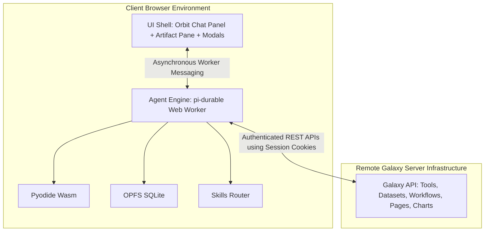
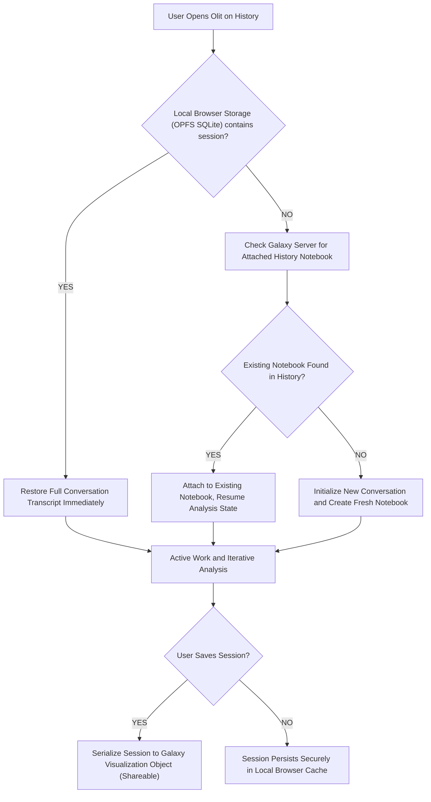

# Chapter 3: System Design and Methodology

## 3.1 System Architectural Overview

Olit is designed with a clear separation between the user interface and the AI's decision-making logic. Figure 3.1 outlines the system architecture, illustrating the strict boundary between the local browser environment and the remote Galaxy server.

*Figure 3.1: Architectural decomposition of Olit, demonstrating client-side execution over remote Galaxy server infrastructure.*

The codebase comprises two primary subsystems:

1. **The UI Shell**
2. **The Agent Engine**

## 3.2 Human-in-the-Loop

A critical vulnerability of naive language model agents is precipitous action: an unconstrained agent given high-level goals may immediately execute unverified tools, consume substantial cluster allocations, or inadvertently overwrite research data.

### 3.2.1 The Execution Lifecycle

To prevent unintended actions, the agent is restricted from executing tools immediately after receiving a user request. Instead, it follows a structured lifecycle:

1. **Data Exploration:** The agent first inspects dataset metadata (such as column names, datatypes, and sample counts) using read-only operations.
2. **Plan Formulation:** It then drafts a step-by-step execution plan. This includes specific tool choices (e.g., FastQC, Trimmomatic) and a detailed table of all proposed parameters.
3. **User Review:** The proposed plan is displayed in the UI, giving the user the option to **Approve**, **Edit**, or **Reject** it. The agent pauses completely until the user makes a decision.
4. **Execution and Tracking:** Once approved, the agent submits the tools to the Galaxy API in the correct order and continuously monitors their progress.

### 3.2.2 Safety Gates for Destructive Actions

Operations that permanently delete data—such as purging histories, deleting datasets, or stopping active workflows—are handled by a dedicated safety mechanism (`destructiveGate`). Even if the agent is already in the middle of an approved execution phase, attempting a destructive action automatically triggers a confirmation modal. If the user declines, the action is blocked to prevent any accidental data loss.

## 3.3 The Dynamic Skills Knowledge Architecture

### 3.3.1 The On-Demand Router Pattern

Olit implements an on-demand **Skills Router** (`skills.ts`).

By loading procedural rules only when active, the agent maintains maximum attentional focus on the immediate operational task.

### 3.3.2 Skills Repositories and Cryptographic Vendoring

Olit organizes procedural knowledge across two repositories:

- **`olit-skills`:**
- **`galaxy-skills`:**

## 3.4 Data Visualization and Interactive Analytics

Data exploration in Olit is managed by a dual-pathway architecture implemented in `visualizations.ts` and `vega.ts`.

## 3.5 Session Resumability and Automated Notebooks

*Figure 3.2: Decision tree for Olit session resumption across browser tabs, local storage, and Galaxy server instances.*

If the user revisits the analysis within the same browser, the complete conversational transcript is immediately restored from local SQLite storage. If accessed from an alternative machine or a fresh browser profile, Olit checks for an attached Galaxy Page notebook; if found, it parses the completed analytical history and resumes seamlessly.

### 3.5.1 Automated Laboratory Notebook Generation

Chat interfaces are not well-suited for long-term scientific record-keeping. To ensure the analysis is permanently documented, Olit automatically generates and updates a **Galaxy Page** in the background:

- **Execution Tracking:** The approved plan is documented as a live Markdown checklist. As jobs finish, the agent updates the status of each step, marking them as complete (`- [x]`) or failed (`- [!]`).
- **Persistent Dataset Linking:** To guarantee exact reproducibility, datasets are referenced using both their simple UI numbers (HIDs) and their permanent, unique internal Galaxy identifiers.
- **Embedding Visualizations:** Interactive charts and figures generated during the session are directly embedded into the page using `{{artifact}}` tags. This turns the session into a clean, shareable summary of the entire workflow.

---

[← Previous: Chapter 2](./02_background.md) | [Main (README)](../README.md) | [Bibliography →](../README.md#bibliography)
